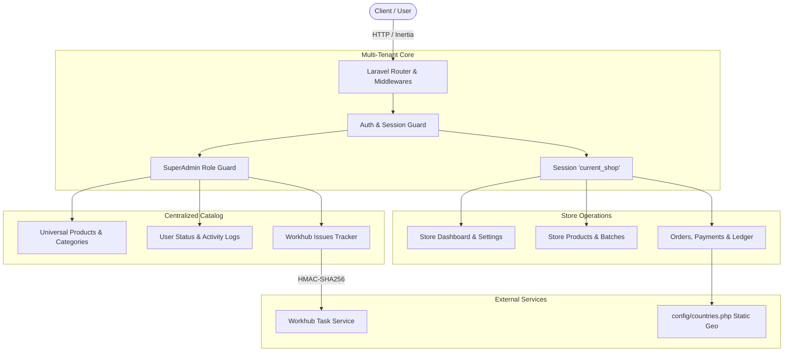

# Project Status Report — ShopEssey Inventory System

> **Current Status**: 🟢 **Operational & Active Development**  
> **Report Date**: October 27, 2026  
> **Application Name**: ShopEssey (`http://inventory.test` / `http://localhost`)  
> **Framework Stack**: Laravel 12.66 (PHP 8.2+) • React 18 • Inertia.js • Tailwind CSS • Vite 5  
> **Latest Git Commit**: [`1bdfadf`](file:///home/subhadip/Herd/Inventory) (*feat: add Workhub and reCAPTCHA environment variables, expand modal sizes, and update universal product form to use DialogModal*)

---

## 1. Executive Summary

**ShopEssey** is an enterprise-grade, multi-tenant inventory, billing, and retail/wholesale pharmacy management application. It bridges centralized master catalog management (Universal Products) with individual store inventory control, batch-level expiry tracking, customer billing, and integrated issue reporting.

The codebase has undergone comprehensive architectural refinement:
- Component library unified into modular namespaces under [`resources/js/Components/`](file:///home/subhadip/Herd/Inventory/resources/js/Components).
- Database migrations squashed and normalized into a clean 20-step sequential pipeline.
- Workhub external task/bug tracker integrated with HMAC-SHA256 signature verification and clipboard paste/drag-and-drop screenshot capabilities.
- Front-end production build verified clean with zero errors ([`npm run build`](file:///home/subhadip/Herd/Inventory/package.json)).

---

## 2. System Architecture & High-Level Flow



---

## 3. Module Status Matrix

| Module | Status | Backend Controller / Model | Frontend View / Component | Key Highlights |
| :--- | :---: | :--- | :--- | :--- |
| **Authentication & Profile** | 🟢 Ready | [`ProfileController`](file:///home/subhadip/Herd/Inventory/app/Http/Controllers/ProfileController.php)<br>[`User`](file:///home/subhadip/Herd/Inventory/app/Models/User.php) | [`Login.jsx`](file:///home/subhadip/Herd/Inventory/resources/js/Pages/Auth/Login.jsx)<br>[`Register.jsx`](file:///home/subhadip/Herd/Inventory/resources/js/Pages/Auth/Register.jsx)<br>[`Edit.jsx`](file:///home/subhadip/Herd/Inventory/resources/js/Pages/Profile/Edit.jsx) | 50/50 split-screen branding, password toggle, reCAPTCHA config readiness, dark mode support. |
| **Store / Tenant Management** | 🟢 Ready | [`ShopController`](file:///home/subhadip/Herd/Inventory/app/Http/Controllers/ShopController.php)<br>[`Shop`](file:///home/subhadip/Herd/Inventory/app/Models/Shop.php) | [`Create.jsx`](file:///home/subhadip/Herd/Inventory/resources/js/Pages/Shop/Create.jsx)<br>[`Edit.jsx`](file:///home/subhadip/Herd/Inventory/resources/js/Pages/Shop/Edit.jsx) | Multi-tenant scoping (`shop_id`), Retail vs. Wholesale classification, dynamic city/state lookup via [`config/countries.php`](file:///home/subhadip/Herd/Inventory/config/countries.php). |
| **Universal Product Catalog** | 🟢 Ready | [`UniversalProductController`](file:///home/subhadip/Herd/Inventory/app/Http/Controllers/UniversalProductController.php)<br>[`UniversalProduct`](file:///home/subhadip/Herd/Inventory/app/Models/UniversalProduct.php) | [`Index.jsx`](file:///home/subhadip/Herd/Inventory/resources/js/Pages/UniversalProduct/Index.jsx) | Master catalog with 23+ categories, verification toggle, search endpoint, [`DialogModal`](file:///home/subhadip/Herd/Inventory/resources/js/Components/Modal/DialogModal.jsx) modal creation. |
| **Store Inventory & Batches** | 🟢 Ready | [`ProductController`](file:///home/subhadip/Herd/Inventory/app/Http/Controllers/ProductController.php)<br>[`BatchController`](file:///home/subhadip/Herd/Inventory/app/Http/Controllers/BatchController.php) | [`Product/Index.jsx`](file:///home/subhadip/Herd/Inventory/resources/js/Pages/Product/Index.jsx)<br>[`Batch/Index.jsx`](file:///home/subhadip/Herd/Inventory/resources/js/Pages/Batch/Index.jsx) | Stores link to universal products with SKU generation. Batch tracking includes purchase price, MRP, batch number, and expiry date. |
| **Customer Management** | 🟢 Ready | [`Customer`](file:///home/subhadip/Herd/Inventory/app/Models/Customer.php) | Associated with Order views | Retail & wholesale customer types, phone uniqueness per shop, GST & Drug License numbers, credit limit, and derived balance calculation. |
| **Orders & Split Billing** | 🟢 Ready | [`OrderController`](file:///home/subhadip/Herd/Inventory/app/Http/Controllers/OrderController.php)<br>[`Order`](file:///home/subhadip/Herd/Inventory/app/Models/Order.php) | [`Orders/Create.jsx`](file:///home/subhadip/Herd/Inventory/resources/js/Pages/Orders/Create.jsx)<br>[`Orders/Index.jsx`](file:///home/subhadip/Herd/Inventory/resources/js/Pages/Orders/Index.jsx) | Strict store session boundary, customer association, order item breakdown, auto-derived `payment_status` (`unpaid`, `partial`, `paid`). |
| **Payments & Customer Ledger** | 🟡 Schema Ready | [`Payment`](file:///home/subhadip/Herd/Inventory/app/Models/Payment.php)<br>[`CustomerLedger`](file:///home/subhadip/Herd/Inventory/app/Models/CustomerLedger.php) | API/Schema complete; UI split-payment view in progress | Schema supports multi-mode payments (cash, online/UPI) and running wholesale ledger balance (`SUM(amount)`). |
| **Workhub Issue Tracking** | 🟢 Ready | [`IssueReportController`](file:///home/subhadip/Herd/Inventory/app/Http/Controllers/IssueReportController.php) | [`IssueReportModal.jsx`](file:///home/subhadip/Herd/Inventory/resources/js/Components/Modal/IssueReportModal.jsx)<br>[`SuperAdmin/Issues/Index.jsx`](file:///home/subhadip/Herd/Inventory/resources/js/Pages/SuperAdmin/Issues/Index.jsx) | In-app bug/feedback reporter with clipboard paste & drag-and-drop screenshot upload, HMAC-SHA256 signature verification, and SuperAdmin issue list. |
| **SuperAdmin Administration** | 🟢 Ready | [`HomeController`](file:///home/subhadip/Herd/Inventory/app/Http/Controllers/HomeController.php)<br>[`superadminUsers`](file:///home/subhadip/Herd/Inventory/app/Http/Controllers/superadminUsers.php) | [`SuperAdmin/Dashboard.jsx`](file:///home/subhadip/Herd/Inventory/resources/js/Pages/SuperAdmin/Dashboard.jsx)<br>[`Tax.jsx`](file:///home/subhadip/Herd/Inventory/resources/js/Pages/SuperAdmin/Tax.jsx) | System dashboard, user status controls, activity audit logs, medicine category configuration, category tax settings. |

---

## 4. Database Migrations & Integrity

The database contains 20 normalized migrations executed and in sync:

```
[1] Ran   0001_01_01_000000_create_users_table
[1] Ran   0001_01_01_000001_create_cache_table
[1] Ran   0001_01_01_000002_create_jobs_table
[1] Ran   2025_08_10_000000_create_user_statuses_table
[1] Ran   2025_08_10_000001_create_user_activity_logs_table
[1] Ran   2025_08_10_000002_create_user_settings_table
[1] Ran   2025_08_15_000000_create_shops_table
[1] Ran   2025_08_15_000001_create_shop_user_table
[1] Ran   2025_08_20_000000_create_medicine_categories_table
[1] Ran   2025_08_20_000001_create_shop_categories_table
[1] Ran   2025_08_20_000002_create_taxes_table
[1] Ran   2025_08_25_000000_create_universal_products_table
[1] Ran   2025_08_25_000001_create_products_table
[1] Ran   2025_08_25_000002_create_batches_table
[1] Ran   2025_08_30_000000_create_customers_table
[1] Ran   2025_08_30_000001_create_orders_table
[1] Ran   2025_08_30_000002_create_order_items_table
[1] Ran   2025_08_30_000003_create_payments_table
[1] Ran   2025_08_30_000004_create_customer_ledgers_table
[1] Ran   2025_12_06_161846_create_category_taxes_table
```

> [!NOTE]
> Database foreign key indexing and cascading deletes are maintained on all multi-tenant tables (`shop_id`, `customer_id`, `product_id`, `order_id`).

---

## 5. Recent Key Updates (Changelog)

### October 2026
- **Commit `1bdfadf`**: Added Workhub and reCAPTCHA credentials to environment configurations, expanded modal dialog sizes (`sm`, `md`, `lg`, `xl`, `2xl`, `3xl`, `4xl`, `5xl`), and updated Universal Product creation to utilize the modern `DialogModal`.
- **Commit `d40559a`**: Added clipboard paste (`Ctrl+V`) and drag-and-drop support for screenshot attachments directly inside `IssueReportModal`.
- **Commit `c6adaae`**: Implemented end-to-end Workhub API integration (`IssueReportController`), including HMAC SHA-256 payload signing, SuperAdmin issue view (`/superadmin/issues`), and frontend trigger button.

### August 2026
- **Store & Onboarding Improvements (`728ff9e`)**: Revamped the shop registration interface with Retail vs Wholesale store selection, streamlined UI validation, and enhanced landing page experience.
- **Design System & Auth Refactor (`7b6a845`)**: Standardized auth views with the 50/50 split-screen layout, custom brand color `#119ABF`, and created [`DESIGN_SYSTEM.md`](file:///home/subhadip/Herd/Inventory/DESIGN_SYSTEM.md) and [`CODING_RULES.md`](file:///home/subhadip/Herd/Inventory/CODING_RULES.md).
- **Component Architecture Restructure (`abf834d`)**: Extracted all UI primitives into clear namespaces:
  - `Components/Buttons/` (`PrimaryButton`, `SecondaryButton`, `DangerButton`, `SaveButton`, `AddButton`, `CancelButton`)
  - `Components/Form/` (`TextInput`, `PasswordInput`, `Checkbox`, `FormSelect`, `SelectInput`, `InputLabel`, `InputError`, `FormTextArea`)
  - `Components/Modal/` (`Modal`, `DialogModal`, `ConfirmModal`, `IssueReportModal`, `AdduserModal`)
  - `Components/UI/` (`CardContainer`, `ApplicationLogo`, `Icons`, `HighLightText`, `StoreSideBar`, `SuperAdminSideBar`)
- **Customer & Order Schema Migration (`3684d10`)**: Added schema and models for Customers, Orders, Payments, and Customer Ledgers for wholesale balance reconciliation.

---

## 6. Build, Test & Performance Metrics

- **Vite Production Bundler**:
  - Command: `npm run build`
  - Status: 🟢 **Passes cleanly (0 errors)**
  - Build Duration: ~9.1s
- **PHP / Laravel Environment**:
  - Laravel Version: **12.66.0**
  - PHP Version: **8.2+**
  - Route Resolution: Operational across store, superadmin, and auth groups.

---

## 7. Immediate Roadmap & Next Steps

1. **Multi-Mode Split Payment UI**:
   - Create checkout modal allowing split payments (e.g., partial cash + online payment for a single bill).
2. **Customer Ledger Statement Screen**:
   - Provide wholesale customers and shop owners a ledger timeline view showing debit sales, credit payments, and running balance.
3. **Batch Expiry & Low-Stock Alerts**:
   - Introduce store dashboard widgets highlighting batches expiring within 30/60/90 days and products falling below minimum inventory thresholds.
4. **Test Suite Refresh**:
   - Update `phpunit.xml` configuration to run database migrations during SQLite in-memory feature tests.

---

*Document generated on October 27, 2026. Keep this document updated upon completing major feature milestones.*
